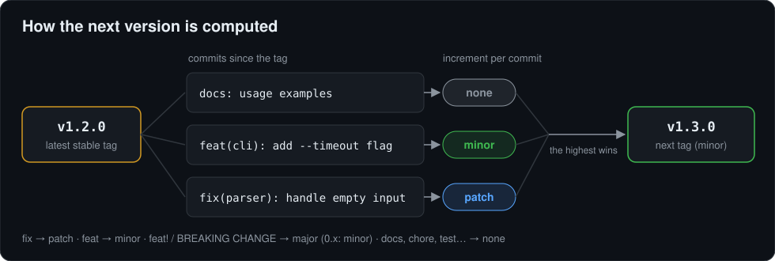

# Go Release Manager

[](https://github.com/fabiodrneles/go-release-manager/actions/workflows/ci.yml)
[](https://github.com/fabiodrneles/go-release-manager/releases)
[](go.mod)
[](LICENSE)

[Português](README.md) · **English**

Automatic semantic versioning from your commits, **without the complexity**.

`go-release-manager` is a lightweight CLI written in Go. It reads the commits since the latest stable version, applies [Conventional Commits](https://www.conventionalcommits.org/en/v1.0.0/) and computes (or creates) the next [SemVer](https://semver.org/) tag. Use it on its own, as a GitHub Action, or as the "brain" of a pipeline with [GoReleaser](https://goreleaser.com/). It computes the versions of [sdd-kit](https://github.com/fabiodrneles/sdd-kit).


## Contents

- [Why use it](#why-use-it)
- [Quick start](#quick-start)
- [Installation](#installation)
- [Step by step: your first version](#step-by-step-your-first-version)
- [Commands and flags](#commands-and-flags)
- [Reading the output](#reading-the-output)
- [How the version is computed](#how-the-version-is-computed)
- [Pre-releases](#pre-releases)
- [Configuration (optional)](#configuration-optional)
- [JSON output](#json-output)
- [GitHub Action](#github-action)
- [Squash merges and breaking changes](#squash-merges-and-breaking-changes)
- [Full release with GoReleaser](#full-release-with-goreleaser)
- [With sdd-kit](#with-sdd-kit)
- [Tips](#tips)
- [Troubleshooting](#troubleshooting)
- [Development](#development)

## Why use it

- **Does one thing well:** it computes the next tag. Build, changelog and release stay with GoReleaser.
- **Single binary:** no `node_modules`, no plugins, no required configuration. Linux, macOS and Windows, on amd64 and arm64.
- **Built for automation:** `next` prints only the version; `--output json` gives the full result. Diagnostics go to stderr, so stdout stays clean for scripts.
- **Safe by default:** `--dry-run` writes nothing and needs no credentials. The tag is created only when you ask for it.
- **Predictable:** the base is always the highest reachable stable tag, and pre-releases continue the channel's counter. The rules are written in [specs](specs/README.md) and covered by tests.

## Quick start

```text
go install github.com/fabiodrneles/go-release-manager@latest   # 1. install
cd my-project                                                  # 2. go into a git repository
go-release-manager create --dry-run                            # 3. see the next version
```

Happy with the result? `go-release-manager create` creates and pushes the tag.

## Installation

### Prebuilt binary (recommended)

Every [release](https://github.com/fabiodrneles/go-release-manager/releases) ships binaries for Linux, macOS and Windows, and a `checksums.txt` (SHA-256) to verify the download.

**Linux and macOS** (replace `Linux_x86_64` with `Linux_arm64`, `Darwin_x86_64` or `Darwin_arm64` for your system):

```text
VERSION=1.2.0
BASE=https://github.com/fabiodrneles/go-release-manager/releases/download/v$VERSION
curl -fsSLO "$BASE/go-release-manager_${VERSION}_Linux_x86_64.tar.gz"
curl -fsSLO "$BASE/checksums.txt"
sha256sum --ignore-missing -c checksums.txt     # on macOS: shasum -a 256 --ignore-missing -c checksums.txt
tar xzf "go-release-manager_${VERSION}_Linux_x86_64.tar.gz" go-release-manager
sudo install go-release-manager /usr/local/bin/
```

**Windows** (PowerShell):

```text
$Version = "1.2.0"
$Base = "https://github.com/fabiodrneles/go-release-manager/releases/download/v$Version"
Invoke-WebRequest "$Base/go-release-manager_${Version}_Windows_x86_64.zip" -OutFile grm.zip
Invoke-WebRequest "$Base/checksums.txt" -OutFile checksums.txt
(Get-FileHash grm.zip -Algorithm SHA256).Hash.ToLower()   # compare with the .zip line in checksums.txt
Expand-Archive grm.zip -DestinationPath "$HOME\bin" -Force
```

Make sure the folder (`$HOME\bin` in the example) is on your `PATH`, then open a new terminal.

### With Go

With Go installed (the module asks for Go 1.26; from Go 1.21 on, `go install` downloads that version by itself):

```text
go install github.com/fabiodrneles/go-release-manager@latest
```

The binary goes to `$(go env GOPATH)/bin`, which must be on your `PATH`.

### Check the installation

```bash
go-release-manager --version
```

## Step by step: your first version

**1. Write commits following Conventional Commits.** The type at the start of the message says what changed:

```text
git commit -m "feat(cli): add --timeout flag"     # new feature → minor
git commit -m "fix(parser): handle empty input"   # bug fix → patch
git commit -m "docs: usage examples"              # no effect on the version
```

**2. See the next version**, without changing anything in the repository:


```bash
go-release-manager next
```

**3. Create the tag.** Without `--dry-run`, `create` creates the tag on the analyzed commit and pushes it to `origin`:

```text
export GITHUB_TOKEN=ghp_...    # or log in once with: gh auth login
go-release-manager create
```

Pushing the tag triggers your repository's release workflow (see [Full release with GoReleaser](#full-release-with-goreleaser)).

## Commands and flags


| Command | What it does |
|---|---|
| `create` | Computes the next version, creates the tag and pushes it to `origin`. With `--dry-run`, only shows it. |
| `next` | Prints only the next version on stdout (nothing when there is no release), for scripts. Never creates a tag. |
| `check-pr` | Checks the PR title and breaking changes before a squash merge (see [Squash merges](#squash-merges-and-breaking-changes)). |
| `--version` | The binary's version. |
| `completion` | Generates shell completion for bash, zsh, fish or PowerShell. |

| Flag | Commands | What it does |
|---|---|---|
| `-d`, `--dry-run` | `create` | Simulates: no tag, no credentials. |
| `-p`, `--pre-release CHANNEL` | `create`, `next` | Pre-release on the channel (`beta`, `rc`, ...). |
| `-o`, `--output text\|json` | `create` | Result format; `json` for automation. |
| `--release-as vX.Y.Z` | `create` | Uses this version instead of the computed one (higher than the latest stable, and not yet a tag). |
| `--explain` | `create`, `next` | Lists the commits that decided the increment (on stderr for `next`). |
| `--ref COMMIT` | `create`, `next` | Analyzes and tags this commit or branch instead of `HEAD`. |

```bash
# Full simulation, no token
go-release-manager create --dry-run

# Only the version, for scripts and GitHub Actions
go-release-manager next

# The next pre-release on the rc channel
go-release-manager next --pre-release rc
```

To follow a version set in your plan, or to tag a commit other than `HEAD`:

```text
go-release-manager create --release-as v2.0.0
go-release-manager create --ref 1a2b3c4
```

## Reading the output

What each line the tool prints means, and what to do about it.

| The tool prints | What it means |
|---|---|
| `No .go-releaserc.yml found. Using the default rules (feat/fix).` | No configuration file; the default rules apply (`feat` → minor, `fix` → patch). See [Configuration](#configuration-optional). |
| `Found .go-releaserc.yml. Loading custom rules.` | `.go-releaserc.yml` was read and its rules apply. |
| `Latest stable version: v1.2.0` | The latest stable version, used as the base. `(none)` when there is no tag yet. |
| `Analyzing 3 commit(s) since tag v1.2.0...` | How many commits since the base were counted. |
| `Skipping non-conventional commit: [...]` | A commit outside the convention (such as a merge) was skipped. Just a note. |
| `Pre-release channel: rc` | The version comes out as a pre-release on this channel. |
| `Analysis done. Highest increment: Minor` | The highest increment among the commits: `None`, `Patch`, `Minor` or `Major`. |
| `Increment: Minor. Next version: v1.3.0` | The computed next version. |
| `No relevant change found (...). No release will be created.` | No `feat`, `fix` or breaking change: no new version, and the command exits without error. |
| `--- DRY RUN ---` … `--- END OF DRY RUN ---` | The simulation summary: nothing was created. `Tag that would be created` is the tag `create` would make. |
| `Creating git tag 'v1.3.0'...` and `Pushing tag 'v1.3.0' to the remote...` | Without `--dry-run`: the tag is being created and pushed to `origin`. |
| `✅ Tag v1.3.0 created and pushed.` | Done: the tag is on GitHub, and the repository's release workflow starts. |
| `Error: ...` | Something stopped the command, and it exits with code 1. The usual causes are in [Troubleshooting](#troubleshooting). |

Diagnostic lines go to stderr. Stdout holds only the result of `next` (the version) and the JSON of `--output json`, so scripts can read stdout without filtering.

## How the version is computed



| Commits since the latest stable version | Next version |
|---|---|
| `fix:` | patch (`v1.2.3` → `v1.2.4`) |
| `feat:` | minor (`v1.2.3` → `v1.3.0`) |
| `feat!:` or a `BREAKING CHANGE:` footer | major (`v1.2.3` → `v2.0.0`); on `0.x`, minor (`v0.3.0` → `v0.4.0`) |
| `docs:`, `chore:`, `test:`, `ci:`, `refactor:`, ... | none |

- **The base is the highest stable tag reachable from the analyzed commit.** Pre-releases (`v2.0.0-beta.1`) and non-SemVer tags (`latest`) are never the base.
- **The highest increment wins:** one `feat` and ten `fix` commits give a minor.
- **With no tags at all**, counting starts from `v0.0.0`; the first `feat` gives `v0.1.0`.
- **Non-conventional commits** (such as "Merge pull request ...") are skipped, with a note on stderr.
- **With no `feat`, `fix` or breaking change** since the latest tag, there is no release: `next` prints nothing and `create` says so and exits with 0.

## Pre-releases


With `--pre-release CHANNEL`, the version gets the channel suffix and a counter that continues from the existing tags:

```text
v1.2.0  +  feat  →  v1.3.0-rc.1  →  v1.3.0-rc.2  →  ...  →  v1.3.0 (without --pre-release)
```

Different channels (`beta`, `rc`) keep their own counters. GoReleaser publishes every tag with a suffix as a pre-release on GitHub.

## Configuration (optional)

Without a file, the default rules in the table above apply. A `.go-releaserc.yml` at the repository root changes **only the listed types**; the others keep the default. Accepted `release` values: `major`, `minor`, `patch` and `none`.

```yaml
releaseRules:
  - type: docs
    release: patch    # documentation also makes a version
  - type: perf
    release: patch
  - type: deps
    release: minor    # new types work too
```

An invalid value (such as `minr`) makes the command fail and name the type and the value, instead of being ignored.

## JSON output


With `--output json`, stdout holds only the JSON; diagnostics stay on stderr.

| Field | What it is |
|---|---|
| `previous` | Latest stable version (empty when there is none). |
| `next` | Next version (empty when there is no release). |
| `increment` | `None`, `Patch`, `Minor` or `Major`. |
| `commits` | How many commits were analyzed. |
| `channel` | Pre-release channel, when there is one. |
| `ref` | Commit (short) where the tag was or would be created. |
| `forced` | `true` when the version came from `--release-as`. |
| `created` | `true` when the tag was created and pushed. |

```text
NEXT=$(go-release-manager create --dry-run --output json | jq -r .next)
```

## GitHub Action

The Action installs the release binary (verifying its checksum) and exposes the result as outputs. It runs on Linux, macOS and Windows runners.

```yaml
name: Release
on:
  workflow_dispatch:
permissions:
  contents: write
jobs:
  tag:
    runs-on: ubuntu-latest
    steps:
      - uses: actions/checkout@v7
        with:
          fetch-depth: 0          # required: without history, the tags are not there
      - id: version
        uses: fabiodrneles/go-release-manager@v1.2.0
        with:
          create: true            # without it, only computes
      - if: steps.version.outputs.created == 'true'
        run: echo "Tag created: ${{ steps.version.outputs.next }}"
```

| Input | Default | What it does |
|---|---|---|
| `version` | `latest` | go-release-manager version to install (`v1.2.0`, `latest` or `source`). |
| `create` | `false` | `true` creates and pushes the tag. |
| `pre-release` | | Pre-release channel (`beta`, `rc`). |
| `release-as` | | Forces this version (`vX.Y.Z`). |
| `ref` | `HEAD` | Commit or branch to analyze and tag. |
| `working-directory` | `.` | Repository to analyze. |
| `token` | `github.token` | Token to download the release and, with `create`, push the tag. |

| Output | What it is |
|---|---|
| `next` | Next version (empty when there is no release). |
| `previous` | Latest stable version. |
| `increment` | `None`, `Patch`, `Minor` or `Major`. |
| `created` | `"true"` when the tag was created and pushed. |
| `ref` | Commit (short) where the tag was or would be created. |
| `forced` | `"true"` when the version came from `release-as`. |

> [!IMPORTANT]
> A tag created with the default `GITHUB_TOKEN` **does not trigger** other workflows (a GitHub rule). To publish the release, call the build in the same workflow (as in the next section), or pass a GitHub App token or a PAT in `token`.

## Squash merges and breaking changes

In a squash merge, only the final commit message decides the version. If the `BREAKING CHANGE:` lives only in the PR description or in one of the squashed commits, and the title has no `!`, the release comes out minor when it should be major. go-release-manager closes that gap in four layers:

1. **Configure squash on GitHub:** in *Settings → General → Pull Requests → Allow squash merging*, pick **Default to pull request title and description**. The PR title and description then become the commit message, and a `BREAKING CHANGE:` footer at the end of the description survives. Without it, a single-commit PR uses that commit's message, not the title.
2. **Check the PR before merging with `check-pr`:** it fails when a breaking change announced anywhere in the PR is not in the title, and suggests the right title. It also warns about a footer outside the last paragraph, about `BREAKING CHANGES:` (with an S, which does not count) and about single-commit PRs.
3. **Safety net after the merge:** the workflow compares the commit that landed on `main` with its PR (`check-pr --merged`) and opens an issue if the break was lost, before the next release.
4. **Understand the version with `--explain`:** `create` and `next` list the commits that decided the increment and the rule behind each one.

```bash
# The title loses the break announced in the description: exits with 1 and suggests "feat!: drop --legacy"
go-release-manager check-pr --title "feat: drop --legacy" --body "BREAKING CHANGE: --legacy was removed" || echo "blocked, as expected"

# A title with "!" passes
go-release-manager check-pr --title "feat!: drop --legacy" --body "BREAKING CHANGE: --legacy was removed"

# Which commits decided the version
go-release-manager create --dry-run --explain
```

```text
Pull request: feat: drop --legacy
Breaking change announced in: PR description
✗ [breaking-not-in-title] the pull request announces a breaking change (PR description), but the title has no "!", and the title is what a squash merge keeps: use "feat!: drop --legacy"
1 error, 0 warnings
```

`check-pr` flags: `--title` and `--body`/`--body-file` (`-` reads stdin), `--commits-file` (JSON array of the commit messages), `--github-event` (the `$GITHUB_EVENT_PATH` of a `pull_request` event), `--merged REF` and `-o json` (fields `ok`, `title`, `breaking`, `sources`, `suggested_title` and `findings`). Exit code 0 without errors and 1 with an error; warnings do not fail.

On GitHub Actions, use the `check-pr` Action. It reads the title and description from the event file (never from the script, so a hostile title cannot inject code) and fetches the PR commits from the API:

```yaml
name: PR check
on:
  pull_request:
    types: [opened, edited, synchronize, reopened]
permissions:
  contents: read
  pull-requests: read
jobs:
  check-pr:
    runs-on: ubuntu-latest
    steps:
      - uses: fabiodrneles/go-release-manager/check-pr@v1.3.0
```

To block the merge, make that check required in *Settings → Branches* (the `main` protection). The post-merge safety net is ready in [post-merge-check.yml](.github/workflows/post-merge-check.yml): copy it and replace `uses: ./check-pr` with `version: source` by `uses: fabiodrneles/go-release-manager/check-pr@v1.3.0`.

What it does not cover: the tool detects **declared** breaks (with `!` or `BREAKING CHANGE:`) somewhere in the PR. A break nobody announced needs a comparison of the public API between versions, which is not done yet.

> [!NOTE]
> **macOS runners:** downloading actions (such as `actions/setup-go`) sometimes fails on macOS with "Failed to download archive" in the *Set up job* step, before any step of your workflow. It is a GitHub instability, not a go-release-manager one: re-run the job. The `go-release-manager` and `check-pr` Actions with `version: latest` or a pinned version do not need `setup-go`; only `version: source` does.

## Full release with GoReleaser

This is the flow this repository uses to publish itself, and the one sdd-kit uses in the projects that adopt it:

1. **The [Release tag](.github/workflows/release-tag.yml) workflow**, started by hand in *Actions → Release tag → Run workflow*, computes the version from the commits (or takes the one in `release-as`) and creates the tag with the Action.
2. **In the same run, it calls the [Release](.github/workflows/release.yml) workflow** through `workflow_call`. That workflow runs `make ci` and publishes the binaries, `checksums.txt` and the notes with GoReleaser.
3. **A `v*` tag pushed by hand** also triggers Release.

To copy the flow, use this repository's two workflows as a template, with your own `.goreleaser.yml`.

## With sdd-kit

In [sdd-kit](https://github.com/fabiodrneles/sdd-kit), go-release-manager decides the version of every phase closing:

- **`sh scripts/sdd-release.sh`** runs `go-release-manager next` on `origin/main`. With the computed version, it opens the `chore/release-vX.Y.Z` PR with the CHANGELOG draft.
- **`sh scripts/sdd-release.sh --tag X.Y.Z`**, after the merge, starts *Release tag*, which uses the Action to create the tag and publish the release.
- **The ROADMAP pins no version:** the version always comes from the commits. A forced version (`release-as`) is used only when the owner asks for it.

## Tips

- **Always run `--dry-run` first:** it shows the base, the analyzed commits, the increment and the tag, without writing anything or needing a token.
- **Use the right type in the commit:** the version comes from it. With squash merges, the PR title becomes the commit: validate it with [`check-pr`](#squash-merges-and-breaking-changes).
- **Breaking change:** mark it with `!` (`feat!: remove --legacy`) or a `BREAKING CHANGE: ...` footer. On `0.x`, it bumps the minor, as SemVer says.
- **In scripts, use `next`:** `VERSION=$(go-release-manager next)`, and check it is not empty before publishing.
- **In CI, check out with `fetch-depth: 0`:** a shallow clone has no tags, and the base becomes `v0.0.0`.
- **Tag a specific commit:** `--ref` tags a commit that already passed CI, even with newer commits on `main`.
- **Shell completion:** `go-release-manager completion bash > /etc/bash_completion.d/go-release-manager` (or `zsh`, `fish`, `powershell`).

## Troubleshooting

| Symptom | Cause and fix |
|---|---|
| "No relevant change found" | No `feat`, `fix` or breaking change since the latest stable tag. Check the types with `git log --oneline <tag>..HEAD`. |
| The base is `(none)`, or the version falls back to `v0.x` | The clone has no tags: run `git fetch --tags`, or use `fetch-depth: 0` in `actions/checkout`. |
| "no access token" | Only `create` without `--dry-run` needs a credential: set `GITHUB_TOKEN` or run `gh auth login`. |
| "failed to push the tag" | git could not push to `origin`: check the remote (`git remote -v`) and write access. In GitHub Actions, give the job `permissions: contents: write`. |
| "the tag already exists" with `--release-as` | The forced version must be new and higher than the latest stable. |
| The tag was created, but no release came out | A tag created with the default `GITHUB_TOKEN` does not trigger workflows: see the note in [GitHub Action](#github-action). |
| "Skipping non-conventional commit" on stderr | A note, not an error: non-conventional commits (such as merges) do not count toward the version. |

## Development

The project follows Spec Driven Development with [sdd-kit](https://github.com/fabiodrneles/sdd-kit):

- the specs live in [`specs/`](specs/README.md) (in Portuguese);
- each ticket has one branch and one PR;
- `make ci` runs before every push: lint, tests with race and 80% minimum coverage, build, and the `bash` blocks of both READMEs.

See [CONTRIBUTING](CONTRIBUTING.md) and the [CHANGELOG](CHANGELOG.md).

```text
make ci        # the same check as CI
make docs      # markdownlint
```

Inspired by the semantic-release philosophy, with a focus on simplicity, native performance and the Go ecosystem.

## License

[MIT](LICENSE)
