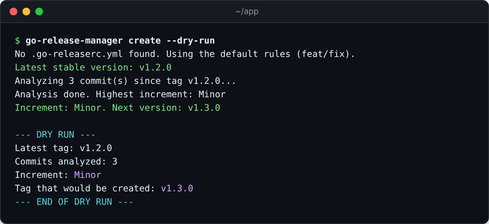
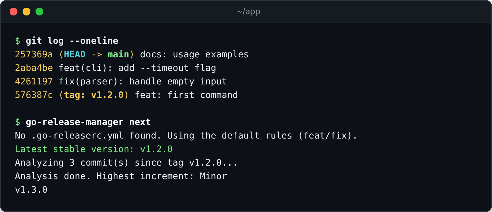
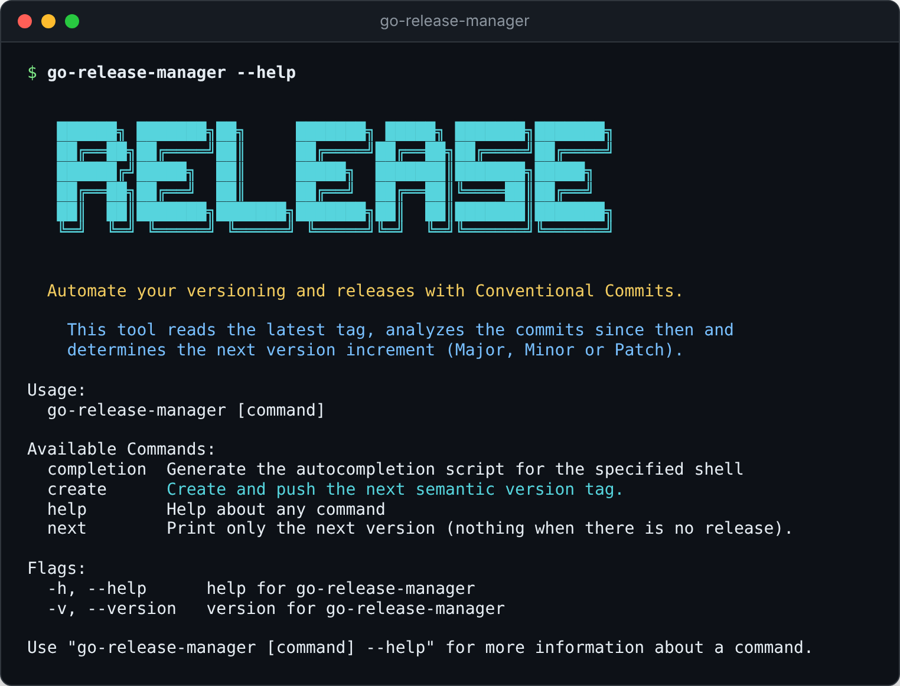
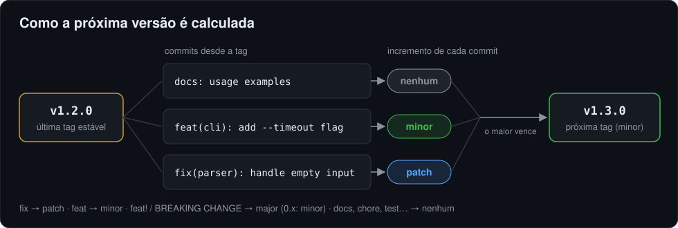
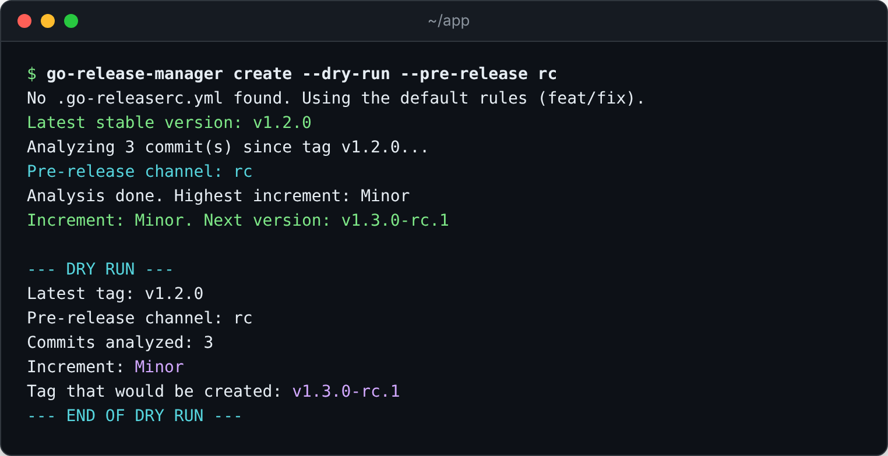
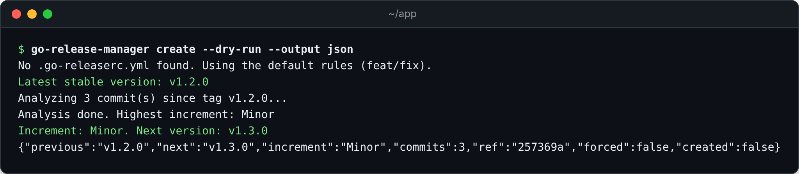

# Go Release Manager

[](https://github.com/fabiodrneles/go-release-manager/actions/workflows/ci.yml)
[](https://github.com/fabiodrneles/go-release-manager/releases)
[](go.mod)
[](LICENSE)

**Português** · [English](README.en.md)

Versionamento semântico automático a partir dos seus commits, **sem a complexidade**.

O `go-release-manager` é uma CLI leve, escrita em Go, que lê os commits desde a última versão estável, aplica o [Conventional Commits](https://www.conventionalcommits.org/pt-br/v1.0.0/) e calcula (ou cria) a próxima tag [SemVer](https://semver.org/lang/pt-BR/). Funciona sozinha, como GitHub Action ou como o "cérebro" de um pipeline com o [GoReleaser](https://goreleaser.com/). É ela que calcula as versões do [sdd-kit](https://github.com/fabiodrneles/sdd-kit).

> A ferramenta fala inglês: a ajuda, as mensagens e os erros saem em inglês. Os comandos, as opções e o JSON são os mesmos descritos aqui.



## Sumário

- [Por que usar](#por-que-usar)
- [Início rápido](#início-rápido)
- [Instalação](#instalação)
- [Passo a passo: a primeira versão](#passo-a-passo-a-primeira-versão)
- [Comandos e opções](#comandos-e-opções)
- [Como a versão é calculada](#como-a-versão-é-calculada)
- [Pré-releases](#pré-releases)
- [Configuração (opcional)](#configuração-opcional)
- [Saída JSON](#saída-json)
- [GitHub Action](#github-action)
- [Release completa com o GoReleaser](#release-completa-com-o-goreleaser)
- [Com o sdd-kit](#com-o-sdd-kit)
- [Dicas](#dicas)
- [Problemas comuns](#problemas-comuns)
- [Desenvolvimento](#desenvolvimento)

## Por que usar

- **Faz uma coisa bem:** calcula a próxima tag. Build, changelog e release ficam com o GoReleaser.
- **Binário único:** sem `node_modules`, sem plugins, sem configuração obrigatória. Linux, macOS e Windows, em amd64 e arm64.
- **Feito para automação:** `next` imprime só a versão; `--output json` entrega o resultado completo. Os diagnósticos vão para o stderr, então o stdout fica limpo para scripts.
- **Seguro por padrão:** `--dry-run` não escreve nada e não precisa de credenciais. A tag só é criada quando você pede.
- **Previsível:** a base é sempre a maior tag estável alcançável, e as pré-releases continuam a contagem do canal. As regras estão em [specs](specs/README.md) e cobertas por testes.

## Início rápido

```text
go install github.com/fabiodrneles/go-release-manager@latest   # 1. instale
cd meu-projeto                                                 # 2. entre num repositório git
go-release-manager create --dry-run                            # 3. veja a próxima versão
```

Gostou do resultado? `go-release-manager create` cria e empurra a tag.

## Instalação

### Binário pronto (recomendado)

Cada [release](https://github.com/fabiodrneles/go-release-manager/releases) traz binários para Linux, macOS e Windows e um `checksums.txt` (SHA-256) para conferir o download.

**Linux e macOS** (troque `Linux_x86_64` por `Linux_arm64`, `Darwin_x86_64` ou `Darwin_arm64` conforme o seu sistema):

```text
VERSION=1.2.0
BASE=https://github.com/fabiodrneles/go-release-manager/releases/download/v$VERSION
curl -fsSLO "$BASE/go-release-manager_${VERSION}_Linux_x86_64.tar.gz"
curl -fsSLO "$BASE/checksums.txt"
sha256sum --ignore-missing -c checksums.txt     # no macOS: shasum -a 256 --ignore-missing -c checksums.txt
tar xzf "go-release-manager_${VERSION}_Linux_x86_64.tar.gz" go-release-manager
sudo install go-release-manager /usr/local/bin/
```

**Windows** (PowerShell):

```text
$Version = "1.2.0"
$Base = "https://github.com/fabiodrneles/go-release-manager/releases/download/v$Version"
Invoke-WebRequest "$Base/go-release-manager_${Version}_Windows_x86_64.zip" -OutFile grm.zip
Invoke-WebRequest "$Base/checksums.txt" -OutFile checksums.txt
(Get-FileHash grm.zip -Algorithm SHA256).Hash.ToLower()   # compare com a linha do .zip no checksums.txt
Expand-Archive grm.zip -DestinationPath "$HOME\bin" -Force
```

Garanta que a pasta (`$HOME\bin` no exemplo) está no `PATH` e abra um terminal novo.

### Com o Go

Com o Go instalado (o módulo pede o Go 1.26; a partir do Go 1.21, o `go install` baixa essa versão sozinho):

```text
go install github.com/fabiodrneles/go-release-manager@latest
```

O binário vai para `$(go env GOPATH)/bin`, que precisa estar no `PATH`.

### Conferir a instalação

```bash
go-release-manager --version
```

## Passo a passo: a primeira versão

**1. Escreva commits no padrão Conventional Commits.** O tipo no começo da mensagem diz o que mudou:

```text
git commit -m "feat(cli): add --timeout flag"     # funcionalidade nova → minor
git commit -m "fix(parser): handle empty input"   # correção → patch
git commit -m "docs: usage examples"              # sem efeito na versão
```

**2. Veja a próxima versão**, sem mudar nada no repositório:



```bash
go-release-manager next
```

**3. Crie a tag.** Sem `--dry-run`, o `create` cria a tag no commit analisado e a empurra para o `origin`:

```text
export GITHUB_TOKEN=ghp_...    # ou faça login uma vez com: gh auth login
go-release-manager create
```

O push da tag dispara o workflow de release do seu repositório (veja [Release completa com o GoReleaser](#release-completa-com-o-goreleaser)).

## Comandos e opções



| Comando | O que faz |
|---|---|
| `create` | Calcula a próxima versão, cria a tag e a empurra para o `origin`. Com `--dry-run`, só mostra. |
| `next` | Imprime só a próxima versão no stdout (nada, se não há release), para scripts. Nunca cria tag. |
| `--version` | A versão do binário. |
| `completion` | Gera o autocompletar para bash, zsh, fish ou PowerShell. |

| Opção | Comandos | O que faz |
|---|---|---|
| `-d`, `--dry-run` | `create` | Simula: não cria tag e não pede credenciais. |
| `-p`, `--pre-release CANAL` | `create`, `next` | Pré-release do canal (`beta`, `rc`, ...). |
| `-o`, `--output text\|json` | `create` | Formato do resultado; `json` para automação. |
| `--release-as vX.Y.Z` | `create` | Usa esta versão no lugar da calculada (maior que a última estável e ainda inexistente). |
| `--ref COMMIT` | `create`, `next` | Analisa e cria a tag nesse commit ou branch, em vez do `HEAD`. |

```bash
# Simulação completa, sem token
go-release-manager create --dry-run

# Só a versão, para scripts e GitHub Actions
go-release-manager next

# A próxima pré-release do canal rc
go-release-manager next --pre-release rc
```

Para seguir uma versão definida no planejamento, ou criar a tag num commit que não é o `HEAD`:

```text
go-release-manager create --release-as v2.0.0
go-release-manager create --ref 1a2b3c4
```

## Como a versão é calculada



| Commits desde a última versão estável | Próxima versão |
|---|---|
| `fix:` | patch (`v1.2.3` → `v1.2.4`) |
| `feat:` | minor (`v1.2.3` → `v1.3.0`) |
| `feat!:` ou rodapé `BREAKING CHANGE:` | major (`v1.2.3` → `v2.0.0`); em `0.x`, minor (`v0.3.0` → `v0.4.0`) |
| `docs:`, `chore:`, `test:`, `ci:`, `refactor:`, ... | nenhuma |

- **A base é a maior tag estável alcançável a partir do commit analisado.** Pré-releases (`v2.0.0-beta.1`) e tags que não são SemVer (`latest`) não servem de base.
- **O maior incremento vence:** um `feat` e dez `fix` dão minor.
- **Sem nenhuma tag**, a contagem parte de `v0.0.0`; o primeiro `feat` dá `v0.1.0`.
- **Commits fora do padrão** (como "Merge pull request ...") são ignorados, com um aviso no stderr.
- **Sem `feat`, `fix` nem mudança incompatível** desde a última tag, não há release: `next` não imprime nada e `create` avisa e sai com 0.

## Pré-releases



Com `--pre-release CANAL`, a versão ganha o sufixo do canal e um contador que continua a partir das tags existentes:

```text
v1.2.0  +  feat  →  v1.3.0-rc.1  →  v1.3.0-rc.2  →  ...  →  v1.3.0 (sem --pre-release)
```

Canais diferentes (`beta`, `rc`) têm contadores próprios. O GoReleaser publica toda tag com sufixo como pré-release no GitHub.

## Configuração (opcional)

Sem arquivo, valem as regras padrão da tabela acima. Um `.go-releaserc.yml` na raiz do repositório muda **só os tipos listados**; os demais continuam com o padrão. Valores aceitos em `release`: `major`, `minor`, `patch` e `none`.

```yaml
releaseRules:
  - type: docs
    release: patch    # documentação também gera versão
  - type: perf
    release: patch
  - type: deps
    release: minor    # tipos novos também valem
```

Um valor inválido (como `minr`) faz o comando falhar e citar o tipo e o valor, em vez de ser ignorado.

## Saída JSON



Com `--output json`, o stdout tem só o JSON; os diagnósticos ficam no stderr.

| Campo | O que é |
|---|---|
| `previous` | Última versão estável (vazio se não há nenhuma). |
| `next` | Próxima versão (vazio se não há release). |
| `increment` | `None`, `Patch`, `Minor` ou `Major`. |
| `commits` | Quantos commits foram analisados. |
| `channel` | Canal de pré-release, quando há. |
| `ref` | Commit (abreviado) onde a tag foi ou seria criada. |
| `forced` | `true` se a versão veio de `--release-as`. |
| `created` | `true` se a tag foi criada e empurrada. |

```text
NEXT=$(go-release-manager create --dry-run --output json | jq -r .next)
```

## GitHub Action

A Action instala o binário da release (conferindo o checksum) e expõe o resultado como outputs. Funciona em runners Linux, macOS e Windows.

```yaml
name: Release
on:
  workflow_dispatch:
permissions:
  contents: write
jobs:
  tag:
    runs-on: ubuntu-latest
    steps:
      - uses: actions/checkout@v7
        with:
          fetch-depth: 0          # obrigatório: sem o histórico, as tags não aparecem
      - id: version
        uses: fabiodrneles/go-release-manager@v1.2.0
        with:
          create: true            # sem isto, só calcula
      - if: steps.version.outputs.created == 'true'
        run: echo "Tag criada: ${{ steps.version.outputs.next }}"
```

| Input | Padrão | O que faz |
|---|---|---|
| `version` | `latest` | Versão do go-release-manager a instalar (`v1.2.0`, `latest` ou `source`). |
| `create` | `false` | `true` cria e empurra a tag. |
| `pre-release` | | Canal de pré-release (`beta`, `rc`). |
| `release-as` | | Força esta versão (`vX.Y.Z`). |
| `ref` | `HEAD` | Commit ou branch onde analisar e criar a tag. |
| `working-directory` | `.` | Repositório a analisar. |
| `token` | `github.token` | Token para baixar a release e, com `create`, empurrar a tag. |

| Output | O que é |
|---|---|
| `next` | Próxima versão (vazio se não há release). |
| `previous` | Última versão estável. |
| `increment` | `None`, `Patch`, `Minor` ou `Major`. |
| `created` | `"true"` se a tag foi criada e empurrada. |
| `ref` | Commit (abreviado) onde a tag foi ou seria criada. |
| `forced` | `"true"` se a versão veio de `release-as`. |

> [!IMPORTANT]
> Uma tag criada com o `GITHUB_TOKEN` padrão **não dispara** outros workflows (regra do GitHub). Para publicar a release, chame o build no mesmo workflow (como na seção abaixo) ou passe em `token` um token de GitHub App ou um PAT.

## Release completa com o GoReleaser

O fluxo que este repositório usa para se publicar, e que o sdd-kit usa nos projetos que adotam o kit:

1. **O workflow [Release tag](.github/workflows/release-tag.yml)**, disparado à mão em *Actions → Release tag → Run workflow*, calcula a versão pelos commits (ou usa a de `release-as`) e cria a tag com a Action.
2. **Na mesma execução, ele chama o workflow [Release](.github/workflows/release.yml)** por `workflow_call`. Esse workflow roda o `make ci` e publica com o GoReleaser os binários, o `checksums.txt` e as notas.
3. **Um push de tag `v*` feito à mão** também dispara o Release.

Para copiar o fluxo, use os dois workflows deste repositório como modelo, com o seu `.goreleaser.yml`.

## Com o sdd-kit

No [sdd-kit](https://github.com/fabiodrneles/sdd-kit), o go-release-manager decide a versão de cada fechamento de fase:

- **`sh scripts/sdd-release.sh`** roda `go-release-manager next` na `origin/main`. Com a versão calculada, ele abre o PR `chore/release-vX.Y.Z` com o rascunho do CHANGELOG.
- **`sh scripts/sdd-release.sh --tag X.Y.Z`**, depois do merge, dispara o *Release tag*, que usa a Action para criar a tag e publicar a release.
- **O ROADMAP não fixa versão:** quem decide é sempre o cálculo pelos commits. Uma versão forçada (`release-as`) só entra a pedido do dono.

## Dicas

- **Rode sempre `--dry-run` antes:** ele mostra a base, os commits analisados, o incremento e a tag, sem escrever nada e sem token.
- **Escreva o tipo certo no commit:** a versão sai dele. Num PR com squash, o título do PR vira o commit, então vale validar o título no CI.
- **Mudança incompatível:** marque com `!` (`feat!: remove --legacy`) ou com um rodapé `BREAKING CHANGE: ...`. Em `0.x`, ela sobe a minor, conforme o SemVer.
- **Em scripts, use `next`:** `VERSION=$(go-release-manager next)` e teste se ficou vazio antes de publicar.
- **No CI, faça checkout com `fetch-depth: 0`:** um clone raso não tem as tags, e a base vira `v0.0.0`.
- **Tag num commit específico:** `--ref` cria a tag num commit que já passou no CI, mesmo com commits novos na `main`.
- **Autocompletar:** `go-release-manager completion bash > /etc/bash_completion.d/go-release-manager` (ou `zsh`, `fish`, `powershell`).

## Problemas comuns

| Sintoma | Causa e solução |
|---|---|
| "No relevant change found" | Não há `feat`, `fix` nem mudança incompatível desde a última tag estável. Confira os tipos com `git log --oneline <tag>..HEAD`. |
| A base é `(none)` ou a versão volta para `v0.x` | O clone não tem as tags: rode `git fetch --tags` ou use `fetch-depth: 0` no `actions/checkout`. |
| "no access token" | Só o `create` sem `--dry-run` pede credencial: defina `GITHUB_TOKEN` ou rode `gh auth login`. |
| "failed to push the tag" | O git não conseguiu enviar para o `origin`: confira o remoto (`git remote -v`) e a permissão de escrita. No GitHub Actions, dê `permissions: contents: write` ao job. |
| "the tag already exists" com `--release-as` | A versão forçada precisa ser nova e maior que a última estável. |
| A tag foi criada, mas a release não saiu | Uma tag criada com o `GITHUB_TOKEN` padrão não dispara workflows: veja o aviso na seção [GitHub Action](#github-action). |
| "Skipping non-conventional commit" no stderr | Aviso, não erro: commits fora do padrão (como merges) não contam para a versão. |

## Desenvolvimento

O projeto segue Spec Driven Development com o [sdd-kit](https://github.com/fabiodrneles/sdd-kit):

- as specs ficam em [`specs/`](specs/README.md);
- cada ticket tem uma branch e um PR;
- o `make ci` roda antes de todo push: lint, testes com race e cobertura mínima de 80%, build e os blocos `bash` deste README.

Veja o [CONTRIBUTING](CONTRIBUTING.md) e o [CHANGELOG](CHANGELOG.md).

```text
make ci        # a mesma verificação do CI
make docs      # markdownlint
```

Inspirado na filosofia do semantic-release, com foco em simplicidade, desempenho nativo e o ecossistema Go.

## Licença

[MIT](LICENSE)
